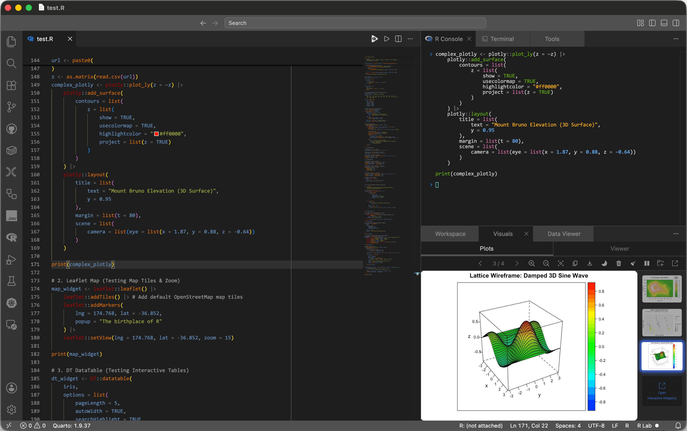

# R Lab

  

An RStudio-inspired development environment for R in VS Code.

> [!NOTE]
> This extension is currently in preview. We are actively refining the layout and feature set. Please report any issues on GitHub!

Transform your editor into an RStudio-inspired 3-pane grid with a single click. Optimized for data science, it includes a live variable explorer, a combined Visuals tab for plots and viewer output, and a high-performance data viewer.

## Core Features

- Instant Layout: Snaps your editor into a 3-pane grid (Source Editor, Terminal/Console/Tools, and Workspace/Visuals/Data Viewer).
- Workspace & Package Manager: Live variable inspector, dictionary-style object previews, and a 1-click interactive data frame viewer. Includes a dedicated tab to search, attach, and detach R packages.
- Visuals: Combined Plots and Viewer subtabs for plot navigation, export, comparison, R `viewer()` output, Shiny apps, `htmlwidgets`, Quarto previews, and vignettes.
- Plot Export: Advanced export settings for PDF, SVG, EPS, PNG, and JPG with smart file size estimation.
- Tools & Smart Execution: Combined R Help and Problems tab, KaTeX help rendering, cross-reference linking, and dynamic code execution (Run Source / Run Selection).

## Getting Started

1. Prerequisite: Ensure you have the official [vscode-R](https://marketplace.visualstudio.com/items?itemName=REditorSupport.r) extension installed.
2. Open a workspace and click "R Lab" in the Status Bar, or run `Toggle R Lab` from the Command Palette.
3. Open an `.R` file and click the source icon in the editor title bar. For `.Rmd`, `.qmd`, or Markdown files, select a code chunk or line and run the selection.

## Key Settings & Commands

| Feature | Description |
| ------- | ----------- |
| `r-lab.rConsoleType` | Select console type (`Auto Detect`, `Standard R`, `Radian`) to enforce bracketed paste. |
| `r-lab.rConsolePath` | Path or command for the R Console terminal (default: `"R"`). |
| `r-lab.restoreCustomPanelPositions` | If true, restores panels to custom dragged locations instead of strict 3-pane. |
| `r-lab.protectLayoutTabs` | Automatically restores accidentally closed R Lab webview tabs and the owned shell Terminal while the layout is active. Defaults to true. |
| `r-lab.plotOutputDir` | Custom directory for R Lab plot images. Defaults to `.R-lab/plots` in the workspace or home directory. |
| `Toggle R Lab` | Snap the editor into or out of the 3-pane grid. |
| `Maximize Top Pane` | Expand the top-right pane; minimizes bottom panes. |

## Contributing

Interested in building the layout, fixing bugs, or reviewing our architecture? See our detailed [Contributing Guidelines](CONTRIBUTING.md) for environment setup and project structure.

## Trademarks & License

- R Logo: Copyright The R Foundation (CC-BY-SA 4.0)
- Tidyverse: Trademark of Posit Software, PBC.
- Bioconductor: Trademark of the Bioconductor Project.
- RDocumentation: Copyright DataCamp, Inc.
- License: [MIT License](LICENSE.txt)
